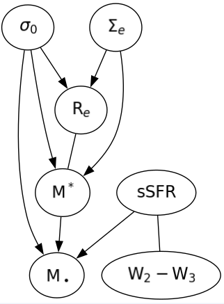
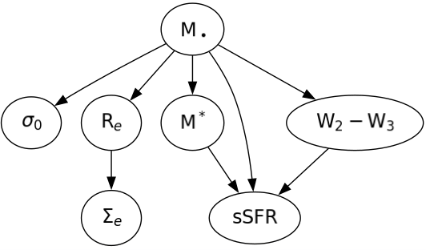
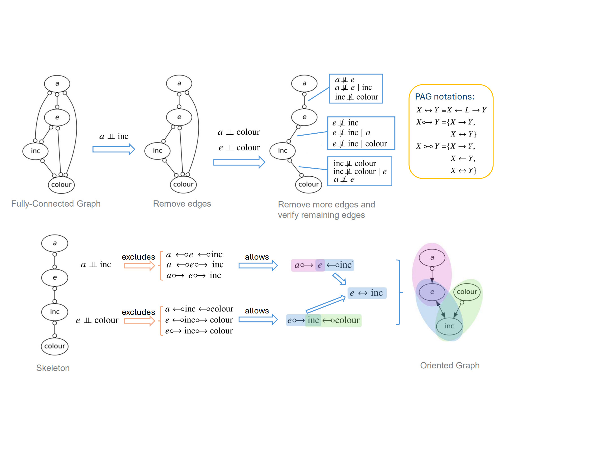
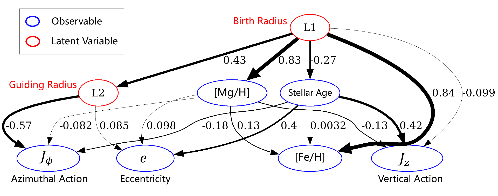

---
# Feel free to add content and custom Front Matter to this file.
# To modify the layout, see https://jekyllrb.com/docs/themes/#overriding-theme-defaults

layout: home
title: "Home"
permalink: /
research_ui: true
collaboration_ui: true
---

Welcome to the personal website of **Zehao Jin (金泽灏)**. 

I study *Astrophysics*, [*Causality*](/intro_to_causality/), and *Machine Learning*. 





 

